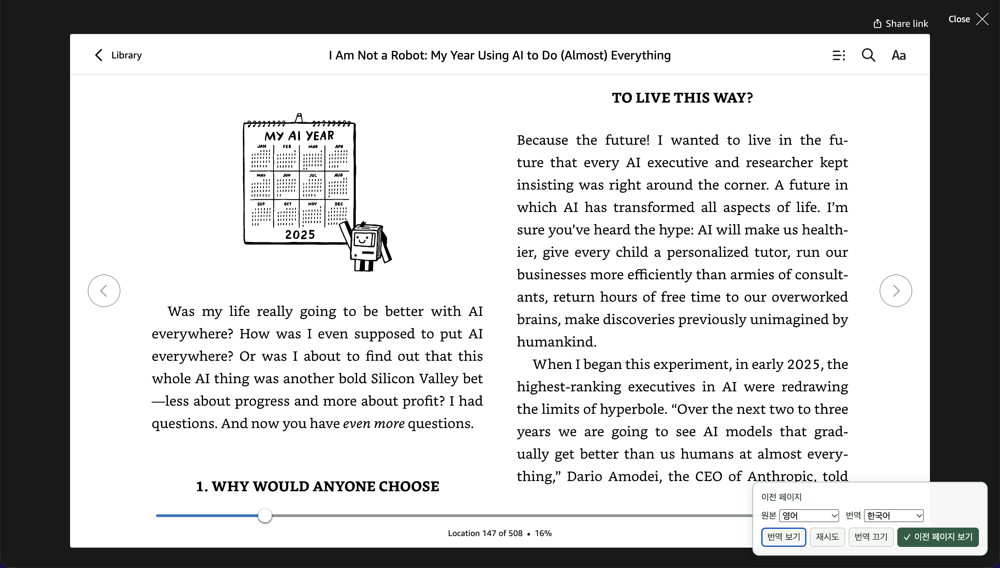
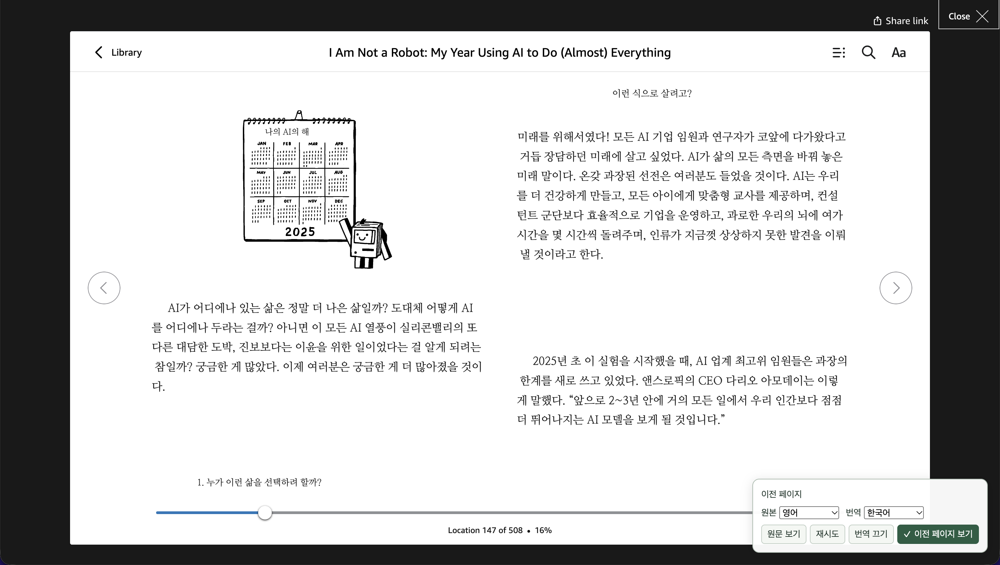

# kindle-ai-translator

[English](README.md)

킨들 웹 리더의 책을 번역하면서 원래 페이지 배치를 최대한 유지하는 Chrome 확장입니다. 번역문을 드래그해서 선택하고 복사할 수 있습니다.

## 동작 예제

같은 킨들 화면의 영어 원문과 한국어 번역입니다. 삽화와 좌우 두 쪽 배치를 유지합니다.

### 원문

### 번역

## 설치

Chrome 116 이상, OpenAI API 키, 설치용 확장 ZIP 파일이 필요합니다. 저장소의 **Download ZIP**은 소스 코드이며 바로 설치할 수 있는 확장 파일이 아닙니다.

1. 설치용 ZIP을 컴퓨터에 계속 보관할 폴더에 압축 해제합니다.
2. `chrome://extensions`에서 **개발자 모드**를 켜고 **압축해제된 확장 프로그램을 로드합니다**를 선택합니다. `manifest.json`이 있는 폴더를 지정합니다.
3. 확장 아이콘을 눌러 API 키와 원본·번역 언어를 설정합니다. 자동 번역을 켜고 저장합니다.
4. 열려 있던 킨들 탭을 새로고침하고 책을 엽니다.

지원 주소: `read.amazon.com`, `read.amazon.co.uk`, `read.amazon.co.jp`, `read.amazon.de`.

## 읽기와 번역

뷰어 오른쪽 아래 메뉴에서 다음 기능을 사용할 수 있습니다.

- 원문과 번역문 전환
- 번역 재시도, 번역 끄기·켜기
- 원본 언어와 번역 언어 변경
- **이전 페이지 보기** 켜기·끄기

**Alt+Shift+T**로 원문과 번역문을 전환합니다. Mac에서는 **Option+Shift+T**입니다. 번역문은 드래그해서 선택하고, 페이지는 킨들의 화살표나 여백을 눌러 넘깁니다.

### 이전 페이지 보기

책에서 바로 앞에 있는 페이지를 보여 주면서 현재 킨들 페이지를 백그라운드에서 번역합니다. 예를 들어 킨들이 3페이지로 이동하면 2페이지를 읽게 됩니다. 다시 2페이지로 돌아가면 캐시에 있는 1페이지를 보여 줍니다.

페이지를 넘길 때는 다음 표시가 준비될 때까지 기존 화면을 유지합니다. 번역문보다 캐시된 원문이 먼저 표시될 수 있습니다. 앞 페이지를 확인할 수 없거나 캐시가 없으면 현재 페이지를 표시합니다.

킨들의 Location과 진행률은 여전히 현재 페이지 기준입니다. 원문·번역 전환은 실제로 보고 있는 페이지에 적용됩니다. 확장이 자동으로 페이지를 넘기거나 아직 방문하지 않은 페이지를 미리 번역하지는 않습니다.

## 설정

확장 아이콘을 눌러 설정을 엽니다. 설정은 모든 킨들 탭에 적용됩니다.

| 항목           | 선택 범위                                                                                                               |
| -------------- | ----------------------------------------------------------------------------------------------------------------------- |
| 원본·번역 언어 | 영어, 한국어, 일본어, 중국어 간체·번체, 스페인어, 프랑스어, 독일어, 포르투갈어, 베트남어. 기본값은 영어 → 한국어입니다. |
| 글꼴           | 나눔고딕 또는 나눔명조. 글꼴에 없는 문자는 시스템 대체 글꼴로 표시합니다.                                               |
| 글자 크기      | 추정한 원문 크기의 70~130%                                                                                              |
| 캐시 크기      | 페이지 이미지 1~30개, 기본 5개. 두 쪽이 한 이미지인 화면은 1개로 셉니다.                                                |

캐시는 임시 저장됩니다. 메모리·유효 기간 제한으로 설정한 수보다 적게 남을 수 있으며, 이전 페이지 보기에 필요한 화면은 우선 보관합니다.

## 개인정보와 비용

문자 인식은 기기에서 실행합니다. 인식한 본문과 관련된 앞 페이지의 원문·번역문은 OpenAI에 전송합니다. 책 이미지는 OpenAI에 보내지 않습니다.

API 키는 이 브라우저의 확장 저장소에 보관하며 동기화하지 않습니다. 기기에 접근할 수 있는 사람은 키에도 접근할 수 있습니다. API 사용료는 ChatGPT 구독과 별도이며, 새 번역과 재시도에는 비용이 발생할 수 있습니다.

## 한계와 문제 해결

- 문자 인식과 번역에는 오류가 있을 수 있습니다. 뜻이 불분명하면 원문과 비교하세요.
- 배치와 글자 크기는 원문을 추정해 맞춥니다. 공간이 부족하거나 원문을 안전하게 덮을 수 없는 문단은 번역하지 않고 남깁니다.
- 표, 수식, 세로쓰기, 사진 위의 글은 제대로 처리하지 못할 수 있습니다.
- 번역에 실패하면 API 키와 계정 잔액·사용 한도를 확인한 뒤 **재시도**를 누르세요.
- 확장을 설치하거나 새로고침한 뒤에는 킨들 탭도 새로고침하세요.
